# RELAY Agent

**A voice-first agent that carries a clinical trial protocol amendment from the new protocol PDF to a signed, validated update of the trial's EDC build.**

You sign in, and the agent catches you up on where the amendment stands across Sponsor, CRO and Site and tells you what is yours to do. When you say "do it", it opens the EDC application and works through it in front of you: a visible cursor moves, fields fill in, pages change. It stops only where a person has to decide: choosing a design, answering an audit question, approving the build, and signing. Every step lands in an audit trail with who did it, the protocol page it came from, the check it passed and its hash.

**▶ Demo video: https://youtu.be/0TKG3HRdpi8**

Built for the Gemini 4 NYC hackathon. Independent concept; not affiliated with or endorsed by Veeva Systems.

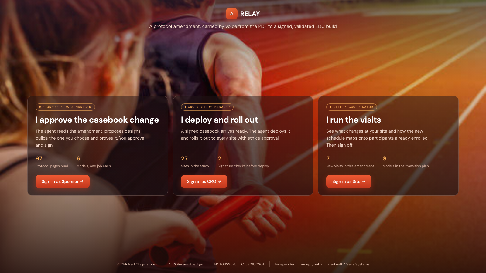

## Contents

- [Status](#status)
- [What you see](#what-you-see)
- [Quick start](#quick-start)
- [Models: one owner per job](#models-one-owner-per-job)
- [How one amendment flows](#how-one-amendment-flows)
- [Architecture](#architecture)
- [Human in the loop](#human-in-the-loop)
- [Trust: ledger, signatures, proof](#trust-ledger-signatures-proof)
- [Run modes: live, replay, fixture](#run-modes-live-replay-fixture)
- [Tests](#tests)
- [Evaluation](#evaluation)
- [Measured on live runs](#measured-on-live-runs)
- [Known limitations](#known-limitations)
- [What is real and what is simulated](#what-is-real-and-what-is-simulated)
- [Built at this hackathon](#built-at-this-hackathon)
- [Repository map](#repository-map)
- [Configuration reference](#configuration-reference)
- [Security notes](#security-notes)

## Status

As of 21 November 2026.

| Area | State |
|---|---|
| All six models reachable | **Proven.** `scripts/smoke_models.py` passes for every model, including a Live voice session through an ephemeral token. |
| Full flow on real models, typed commands | **Proven.** Sponsor, CRO and Site all completed live in the real UI. See [Measured on live runs](#measured-on-live-runs). |
| Replay of a recorded live run | **Proven.** `replays/live5` replays all three roles with no network. |
| Voice in the browser (microphone, barge-in, ignoring side conversations) | **Not tested.** The API path passes the smoke test; nobody has spoken to it yet. |
| Evaluation tables | **Mostly not run.** The dataset is built and frozen; the model-dependent rows say "not run". |
| Agent working in the existing RELAY environment while the protocol is read | **Working**, checked once with the real navigator model. |

[GATES.md](GATES.md) lists every build step with the command that proves it and whether it has passed. [NOTES.md](NOTES.md) lists assumptions. [eval/FAILURES.md](eval/FAILURES.md) logs what broke and how it was fixed, including on the first live runs.

## What you see

**1. Sign in.** Pick a role: Sponsor data manager, CRO study manager, or Site coordinator at one of 27 sites.

**2. The voice page.** A warm, almost empty page with a copper orb. The orb has four states: listening, thinking, acting, waiting for you. The agent greets you by name and says what happened while you were away and what is yours next. For example, the CRO hears that the sponsor signed casebook version 2, with which option and how many tests passed, and that deployment is theirs.

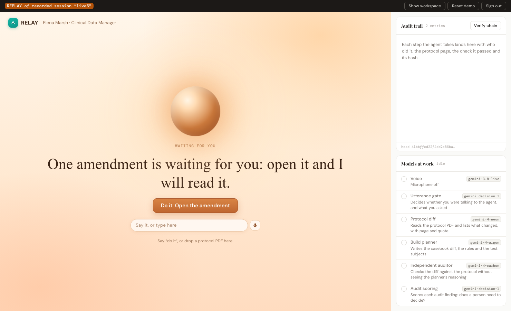

**3. "Do it."** For the sponsor, the agent reads the protocol. While it reads, the existing RELAY environment opens beside the orb and the agent does one small task in it (opens the Sponsor workspace, then the visit schedule) so you can watch it work.

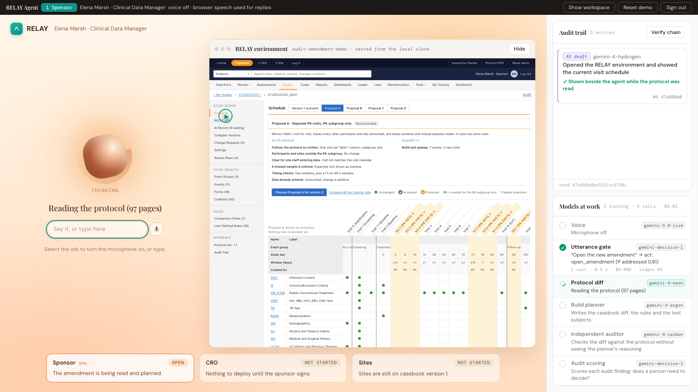

**4. Gates.** The agent proposes two or three designs, states the tradeoff in two sentences and waits. After you choose, it asks about the audit findings that most need a person.

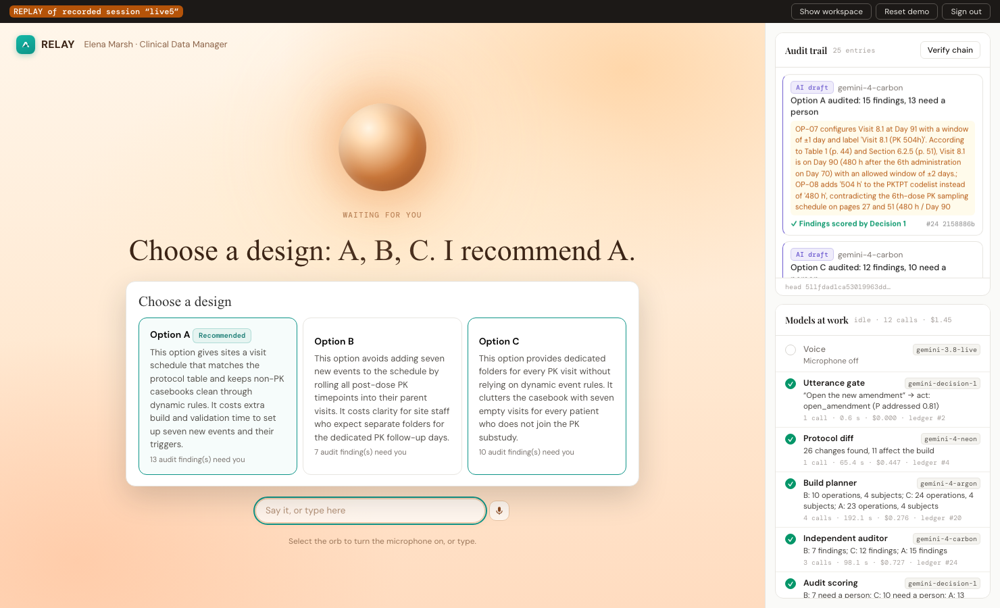

**5. The build.** The EDC application opens and the agent drives it. On the right, the audit trail fills in, and "Models at work" shows which model is doing what, with calls, seconds, cost and the ledger entry it reached.

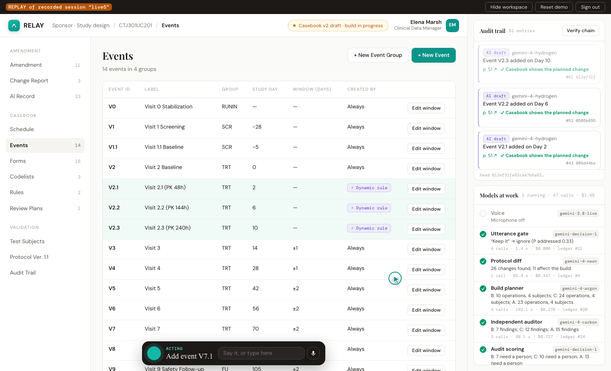

**6. Verification and approval.** A fixed rule compares the built casebook with the plan, the rule engine runs the synthetic subjects, and the ledger chain is recomputed. Only if all three pass does the agent ask for approval.

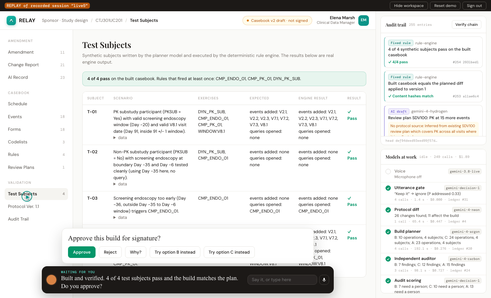

**7. Signing.** Voice can approve. Signing opens a dialog that asks for user ID and password again and states the meaning. The signature is bound to the hash of the record.

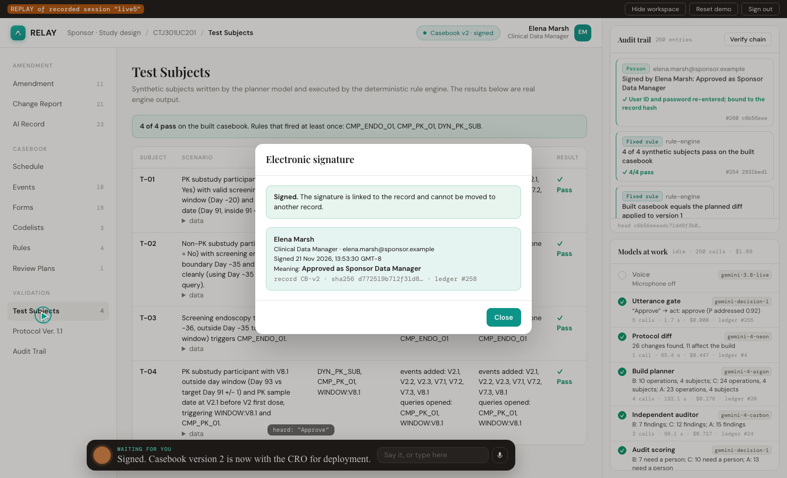

**8. Handoff.** The CRO signs in, is caught up, and the agent deploys and rolls out to the sites with ethics approval. The Site signs in, sees the transition plan for participants already enrolled, and signs off.

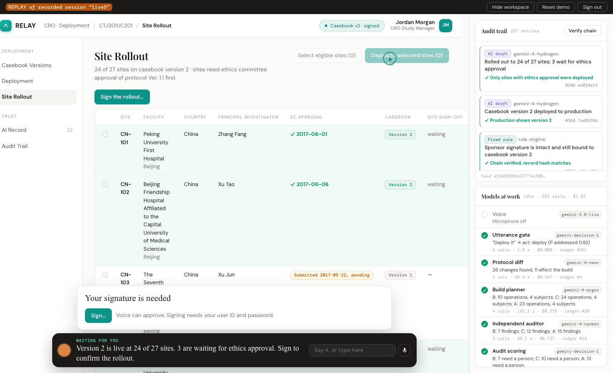
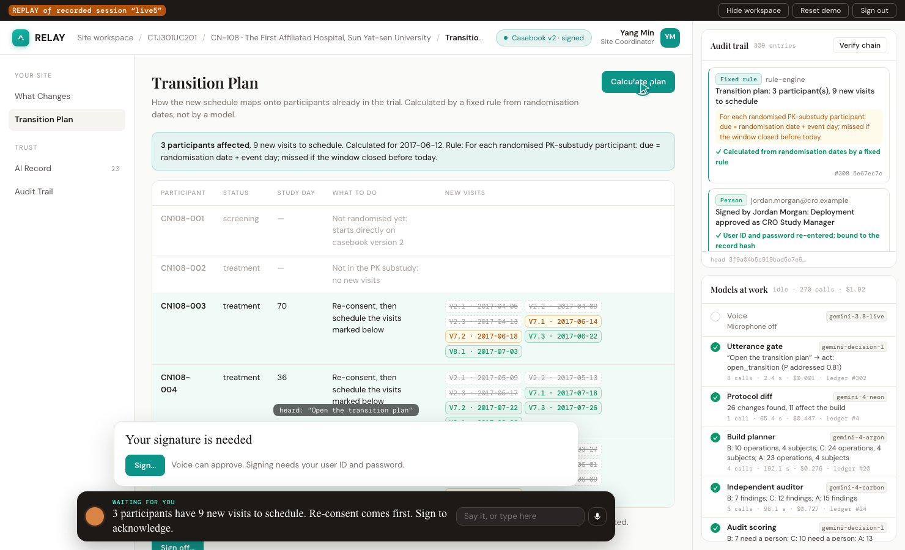

Screenshots 02 to 12 were taken while replaying a recorded live run, so the content is real model output; the amber REPLAY label in them says so. Screenshot 13 is from a live run taken slightly earlier, before the cards along the bottom of the voice page were removed.

## Quick start

Requirements: Python 3.11 or later (the Gemini SDK needs it), Node 22 or later, and a Gemini API key with access to the Gemini 4 models.

```sh
# 1. backend
python3.12 -m venv backend/.venv
backend/.venv/bin/pip install -r backend/requirements.txt

# 2. frontend
cd frontend && npm install && npm run build && cd ..

# 3. key
cp .env.example .env          # then put your key after GEMINI_API_KEY=

# 4. check the models (one small real call each)
backend/.venv/bin/python scripts/smoke_models.py

# 5. run
scripts/dev_server.sh         # http://127.0.0.1:8017
```

Optional, for the environment panel on the voice page:

```sh
git clone https://github.com/prove-ai/audit-amendment-demo reference
```

Then open http://127.0.0.1:8017, pick a role and sign in. Demo sign-in accepts any password. **Signing a record needs the real demo password, `relay-demo-2026`.**

Things to say or type (the box under the orb takes typed commands; select the orb to turn the microphone on):

| Say | What happens |
|---|---|
| "Open the new amendment", "do it" | Starts the next task that is yours |
| "Go with option B", "try option A instead" | Chooses or switches the design |
| "Keep it", "drop it" | Answers an audit question |
| "Why?" | The agent reads back the stored reason for the current step |
| "Show me the source" | Opens the protocol PDF at the cited page with the quote highlighted |
| "Approve", "reject" | Decides at the approval gate |
| "Stop", "continue", "go back" | Pauses, resumes, or returns to the previous gate |

You can also drop a protocol PDF on the voice page before the amendment is opened.

The server port is 8017 by default; set `RELAY_PORT` to change it. For frontend development with hot reload, run `npm run dev` in `frontend/` (port 5173, proxies to the backend).

## Models: one owner per job

Six models. Each has exactly one job, and model IDs live only in [`config/models.yaml`](config/models.yaml). All were confirmed against the official docs and SDK ([docs/model_check.md](docs/model_check.md)) and then by a live smoke test.

| Job | Model | Why this model |
|---|---|---|
| Voice in and out | `gemini-3.8-live` | Real-time speech with barge-in. It listens and speaks; it decides nothing. Not a Gemini 4 model, so it does not count toward the hackathon's two. |
| Utterance gate | `gemini-decision-1` (Decisions API) | For every user turn, audio plus transcript: is it addressed to the agent, what is the intent, is it about the task. It returns calibrated probabilities, so thresholds decide between acting, asking "Was that for me?", and saying nothing. |
| Protocol diff | `gemini-4-neon` | Reads a whole protocol in one pass (1M-token context) and returns a typed change list with page and quote. |
| Build planner and engineer | `gemini-4-argon` | Turns changes into a typed casebook diff, writes the rule expressions, and writes synthetic subjects that exercise each rule. |
| Navigator | `gemini-4-hydrogen` | Fast and cheap enough for an action loop: sees the element list and a screenshot, returns the next UI actions as function calls. |
| Independent auditor | `gemini-4-carbon` | A different model that never sees the planner's reasoning. Checks the diff against the protocol and reports what is untraceable, contradictory or missing. |
| Step verifier and audit scoring | `gemini-decision-1` | After every navigator action: did it succeed, does the screen match. Also scores each audit finding so routing to a person uses a probability. |

Deliberately **not** a model:

- the rule engine that executes edit checks and dynamic rules;
- the citation check (is this quote really on the cited page of the PDF);
- the check that the built casebook equals the plan;
- the transition plan for enrolled participants;
- the catch-up briefing at sign-in, and the answer to "why?" (both are read back from recorded state);
- the ledger and the signature service.

## How one amendment flows

The orchestrator is an explicit state machine, not a free-running chat loop. Models act inside a state; only the machine decides which state may follow and which role may cause it.

```mermaid
stateDiagram-v2
  direction LR
  [*] --> intake
  intake --> diff: person opens the amendment
  diff --> plan: Neon, then citation check
  plan --> audit: Argon, then rule engine
  audit --> gate_option: Carbon, then Decision 1 scoring
  gate_option --> build: person chooses a design
  build --> verify: Hydrogen drives the UI
  build --> gate_option: aborted
  verify --> gate_approve: build equals plan, tests pass, chain intact
  verify --> gate_option: any check fails
  gate_approve --> sign: person approves
  gate_approve --> gate_option: person rejects
  gate_approve --> build: person picks another option
  sign --> handoff_cro: sponsor signs
  sign --> gate_approve: go back
  handoff_cro --> deploy: CRO says do it
  deploy --> rollout: deployed
  rollout --> handoff_site: CRO signs
  handoff_site --> transition: Site says do it
  transition --> site_sign: plan calculated
  site_sign --> [*]: Site signs
```

| State | Owner | Who works | What is checked |
|---|---|---|---|
| `diff` | Sponsor | Neon reads the PDF and lists changes | Every quote is looked up in the PDF by fixed code. Found elsewhere: the page is corrected. Not found: the change is not used. |
| `plan` | Sponsor | Argon proposes options, then writes the diff and test subjects for each, in parallel | The diff is applied to a copy of casebook v1 and the subjects are run. On failure the engine's error messages go back to Argon once. Still invalid: the option is dropped. |
| `audit` | Sponsor | Carbon audits each option; Decision 1 scores each finding | Carbon receives the diff with the planner's rationale, uncertainty and basis stripped out. |
| `gate_option` | Sponsor | Person | The agent states the recommended option's tradeoff and waits. |
| `build` | Sponsor | Hydrogen enters each operation through the UI; Decision 1 checks a screenshot after every action | After each operation a fixed rule checks that the casebook shows it. If not, the navigator is told what is missing and retries. |
| `verify` | Sponsor | Rule engine | Built casebook equals plan (content hash); synthetic subjects pass on the built casebook; ledger chain recomputes. |
| `gate_approve`, `sign` | Sponsor | Person | Approval by voice or click; signature by user ID and password. |
| `deploy`, `rollout` | CRO | Hydrogen | The sponsor signature is re-verified against the casebook before deploying. Only sites with ethics approval can be deployed; the API refuses others. |
| `transition`, `site_sign` | Site | Rule engine, then person | The plan is arithmetic on randomisation dates. No model. |

## Architecture

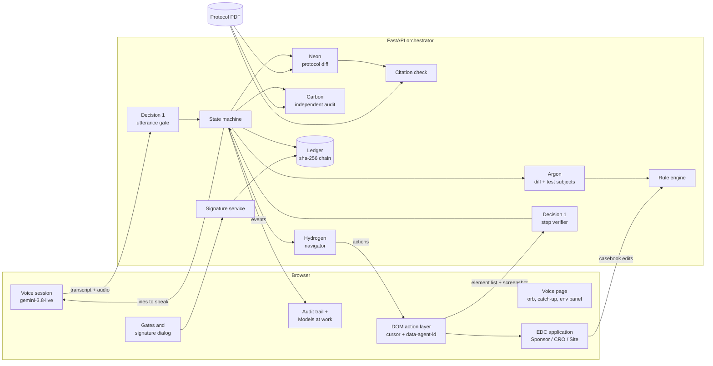

**Frontend** (React, Vite, TypeScript), two layers:

- *The EDC application* (`frontend/src/edc/`): three role workspaces. Every interactive element carries a stable `data-agent-id`. A person can use it by hand; the agent uses the same controls.
- *The agent overlay* (`frontend/src/overlay/`): the orb, captions, cursor, audit trail, "Models at work", gates, the signature dialog and a PDF viewer that highlights the cited quote.

**The DOM action layer** ([`frontend/src/agentActions.ts`](frontend/src/agentActions.ts)). The navigator names an element by `data-agent-id`. The layer moves the visible cursor there, highlights it and fires real DOM events, so the application behaves exactly as it does for a person and the application's own API validates every change. It then returns the list of elements on screen and a screenshot. When a dialog is open, only the dialog's elements are offered, as for a person.

**The environment panel** ([`frontend/src/envActions.ts`](frontend/src/envActions.ts)). The existing RELAY concept site is served from the local `reference/` clone at `/env/` and shown in a frame on the voice page. That site has no agent ids, so the layer derives ids from each control's label. It is served locally because a browser will not let a page move a mouse or click inside a frame from another website.

**Backend** (Python, FastAPI): the orchestrator and state machine, model clients, casebook store, rule engine, ledger, signatures and ephemeral-token minting for the Live session. Events go to the UI over a WebSocket. Python was chosen because the Decisions and Live examples in the official docs are Python-first and the eval harness needs Python anyway, so the eval calls the same agent functions the app does.

**The rule engine** ([`backend/relay/rules.py`](backend/relay/rules.py)) parses and executes rules that the planner writes as data:

```text
Dynamic rule    If    $V2.RAND.PKSUB = "Yes"
                Then  add events V2.1, V2.2, V2.3, V7.1, V7.2, V7.3, V8.1

Edit check      If    abs((PK.PKDTC - $V2.EX.EXSTDTC) - 48h) > 1h
                Then  open query "PK sample is outside the 48 h ± 1 h window"
                Scope PK @ V2.1
```

References are `$EVENT.FORM.ITEM` (absolute) or `FORM.ITEM` (the form at the event being checked). Durations such as `48h` and `2d` are hours; a datetime minus a datetime is hours. A comparison with a missing value is "not evaluable" and does not fire. Visit windows are event properties checked by one built-in rule. The engine runs the planner's synthetic subjects for real, and those results are the "how it was tested" answer in the AI Record.

**The casebook** ([`backend/relay/casebook.py`](backend/relay/casebook.py)) is the EDC build: event groups, events, forms, items, schedule, codelists, rules and review plans. A casebook diff is a list of flat typed operations: `add_event_group`, `add_event`, `set_event_window`, `add_form`, `add_item`, `assign_form`, `add_codelist_entries`, `add_rule`, `modify_rule`, `update_review_plan`.

## Human in the loop

The agent navigates; the human decides.

- **It stops at gates.** Choosing a design, audit questions, approving the build, and each signature. At a gate it states the tradeoff in two sentences and waits.
- **You can interrupt.** "Stop" pauses between actions; "continue" resumes; "go back" returns to the previous gate; "try option B instead" rebuilds from casebook v1.
- **It asks, it does not assume.** Audit findings that Decision 1 scores as needing a person are asked aloud. If there are more than two, it asks about the two most serious and says that the rest are listed on the Amendment page and in the ledger. None is dropped silently.
- **It ignores what is not for it.** Each turn goes through the utterance gate. Below the lower threshold it says nothing at all; in between, and on topic, it asks "Was that for me?".
- **It refuses rather than guesses.** If the engine rejects the plan twice, or the build does not equal the plan, or a test fails, or the chain does not verify, it does not ask for approval. It says what failed and returns to the design gate.
- **Roles cannot act out of turn.** The state machine and the API both enforce it: a CRO cannot deploy before the sponsor signs, and the casebook is locked outside a build.

## Trust: ledger, signatures, proof

**Ledger** ([`backend/relay/ledger.py`](backend/relay/ledger.py)). Append-only, in the style of an ALCOA+ audit trail. Every entry has: sequence number, UTC timestamp, actor type (person, AI, fixed rule), actor ID, role, action, record, before and after values, reason, source citation, and for AI entries the model and a hash of the prompt. Each entry is frozen when written and carries

```text
hash = sha256(prev_hash + canonical_json(entry))
```

"Verify chain" recomputes the whole chain and reports the first broken entry, and re-checks every signature's binding.

**Signatures** ([`backend/relay/signatures.py`](backend/relay/signatures.py)), in the style of 21 CFR Part 11:

- two distinct components, user ID and password, entered again every time (11.200);
- an explicit meaning, for example "Approved as Sponsor Data Manager";
- a manifestation with printed name, date and time, and meaning, shown on the record (11.50);
- a ledger entry bound to the SHA-256 of the record it signs (11.70). Change the record afterwards and verification fails.
- A spoken "yes" never reaches the signature service. Three failed attempts lock signing for that user.

**AI Record.** For each change in the chosen build, five answers: the protocol page and quote it came from, what was done, how it was tested, what is uncertain (the planner's own doubt and the independent auditor's findings), and who reviewed it.

**Audit trail and Models at work.** The right-hand rail shows each step as it happens, labelled AI draft, Fixed rule or Person, with a link to the protocol page, the check it passed and its ledger hash. Below it, one row per stage shows the model ID, what it is doing, calls, seconds, cost and the last ledger entry.

## Run modes: live, replay, fixture

| Mode | Start | What it is |
|---|---|---|
| **Live** (default) | `scripts/dev_server.sh` | Every model step is a real call. Needs `GEMINI_API_KEY`. |
| **Record** | `RELAY_RECORD=take1 scripts/dev_server.sh` | Live, and every model response is saved under `replays/take1/`. |
| **Replay** | `RELAY_REPLAY=take1 scripts/dev_server.sh` | Plays a recording back in the same order with the same timing and no network. `RELAY_REPLAY_SPEED=8` plays it eight times faster. The UI shows an amber REPLAY label. |
| **Fixture** | `RELAY_MODE=fixture scripts/dev_server.sh` | Hand-written stand-ins for the model outputs (`backend/relay/fixtures.py`). For developing the UI and for tests without a key. Labelled in red everywhere, including the ledger. Never used for eval numbers or for the demo. |

`replays/live5` is a complete recorded live run of all three roles. It was recorded before the environment panel existed, so replay it with the panel off:

```sh
RELAY_REPLAY=live5 RELAY_REPLAY_SPEED=8 RELAY_TOUR=0 scripts/dev_server.sh
```

A replay is only as flexible as its recording: it expects the same commands in the same order. Voice is never replayed; in replay mode the browser's own speech synthesis reads the agent's lines.

## Tests

```sh
cd backend && .venv/bin/python -m pytest -q     # 36 tests
cd frontend && npm test                         # 5 tests
backend/.venv/bin/python eval/run_flow.py       # all three roles in a headless browser
```

| Suite | Covers |
|---|---|
| `backend/tests/test_core.py` | Rule language and evaluation; casebook diff, validation and comparison; ledger chaining and tamper detection (edit, delete, re-hash); signature binding, both components, wrong person, wrong meaning, lockout; state machine transitions and role ownership; transition plan |
| `backend/tests/test_flow.py` | The orchestrator through all three roles with a fake UI: audit questions, option switching, pause and resume, roles acting out of turn, tampering with a signed casebook |
| `backend/tests/test_llm.py` | The SDK wrapper through the real SDK with a mocked transport: request shapes, response parsing, record and replay, the auditor not seeing the planner's reasoning, utterance routing thresholds |
| `frontend/src/agentActions.test.tsx` | The DOM action layer: element list, navigation, typing, selecting, clicking through real React handlers, error reporting |
| `eval/run_flow.py` | The real UI in a headless browser. The human's part is typing commands and filling the signature dialog; everything else is the agent. Works in any run mode. |

## Evaluation

The eval is designed to show the system on inputs nobody prepared it for.

**Dataset.** [`eval/fetch_ctgov.py`](eval/fetch_ctgov.py) queries the ClinicalTrials.gov API v2 for interventional studies with posted protocol documents, takes candidates in NCT order, and keeps a study if its protocol contains a sponsor-written summary of changes, or (up to a cap of 10) if more than one protocol version is posted. The demo study is excluded. The split is by hash of the NCT ID and frozen in [`eval/manifest.json`](eval/manifest.json), with a SHA-256 for every PDF.

**Gold labels.** The sponsor's own summary of changes, parsed out of the PDF by [`eval/gold.py`](eval/gold.py). The sponsor wrote it, not us.

**Two settings**, reported separately:

- *Two versions, summary removed.* The model gets the previous and new PDFs with the summary-of-changes pages cut out of the new one, so it has to find the changes itself.
- *Single PDF, summary visible.* An easier reading task.

**Arms.** RELAY (Neon with the engineered prompt, then the citation check); B1, one Neon call with a plain prompt; B2, one Hydrogen call with the same plain prompt.

**Metrics.** Change recall and precision against gold; the share of quotes found on the cited page; invented changes (quote not found anywhere in the PDF); auditor catch rate on errors planted in Argon's diffs; navigator step success, recoveries and end-to-end completion; voice correct-action and false-action rates under noise; cost and latency.

All numbers below are generated by `eval/run_eval.py report` from `eval/results/*.json`.

<!-- EVAL:START -->
Dataset: 25 studies from ClinicalTrials.gov (17 test, 8 dev; 15 with a sponsor summary of changes, 25 with two posted protocol versions). Frozen 2026-11-21.

**Two versions, summary of changes removed (the model must find the changes)**, test split

| Arm | Studies | Change recall | Precision | Quote on cited page | Invented changes per study | Cost per amendment | Latency |
|---|---|---|---|---|---|---|---|
| RELAY (Neon + citation check) | not run | | | | | | |
| B1: one Neon call | not run | | | | | | |
| B2: one Hydrogen call | not run | | | | | | |

_Not run yet: these need `GEMINI_API_KEY`._

**Single PDF, summary of changes visible**, test split

| Arm | Studies | Change recall | Precision | Quote on cited page | Invented changes per study | Cost per amendment | Latency |
|---|---|---|---|---|---|---|---|
| RELAY (Neon + citation check) | not run | | | | | | |
| B1: one Neon call | not run | | | | | | |
| B2: one Hydrogen call | not run | | | | | | |

_Not run yet: these need `GEMINI_API_KEY`._

**Auditor catch rate** (errors planted in Argon's diff; Carbon is not told where)

_Not run yet._

**Navigator reliability** (full sponsor flow in the real UI)

| Mode | Runs | Completed end to end | Steps | Step success (verifier) | Goal success | Recoveries | Median time |
|---|---|---|---|---|---|---|---|
| Live: Hydrogen picks the actions | not run | | | | | | |
| Fixture: hand-written actions (tests the UI and action layer only) | 20 | 20 (100%) | 1808 | n/a | 100% | 0 | 16.60 s |

**Voice robustness**

_Not run yet: needs recordings from at least three speakers (see `eval/audio/README.md`) and `GEMINI_API_KEY`._
<!-- EVAL:END -->

To fill in the missing rows:

```sh
py=backend/.venv/bin/python
$py eval/run_eval.py gold --split test
$py eval/run_eval.py diff --split test --arm system
$py eval/run_eval.py diff --split test --arm b1
$py eval/run_eval.py diff --split test --arm b2
$py eval/run_eval.py auditor --n 3
$py eval/run_eval.py nav --runs 20            # against a live-mode server
$py eval/voice_eval.py                        # after recording; see eval/audio/README.md
$py eval/run_eval.py report
```

These make real model calls and cost money. A live navigator run costs about $2 and takes about 9 minutes, so 20 runs is roughly $40 and 3 hours.

## Measured on live runs

From the recorded run `replays/live5` on 21 November 2026, protocol CTJ301UC201 Ver. 1.1 (97 pages). This is one run, not an average.

| | Sponsor | CRO | Site |
|---|---|---|---|
| End to end | 535 s | 24 s | 9 s |
| Of which, to the design gate | 190 s | | |
| Operations built by the navigator | 23 of 23 | 2 goals of 2 | 1 goal of 1 |
| UI actions | 153 | 5 | 2 |
| Built casebook equals the plan | Yes | | |
| Synthetic subjects passing | 4 of 4 | | |
| Result | Approved and signed | 24 of 27 sites live, signed | 3 participants in the plan, signed |
| Model calls, cost | 250, $1.89 | | |

Where the time and money went in a comparable run (`replays/live3`, 24 operations, $1.93 in total):

| Job | Model | Calls | Seconds | Cost |
|---|---|---|---|---|
| Independent audit, 3 options | Carbon | 3 | 86 | $0.72 |
| Navigation | Hydrogen | 87 | 283 | $0.48 |
| Protocol diff | Neon | 1 | 64 | $0.45 |
| Options, then diff and subjects for 3 options | Argon | 4 | 173 | $0.27 |
| Step verification | Decision 1 | 155 | 111 | $0.01 |
| Audit scoring, utterance gate | Decision 1 | 7 | 2 | under $0.01 |

Seconds are summed across calls; several of these run in parallel.

What the models actually found is not the "seven PK visits" story of the earlier concept demo. On this protocol Neon returns about 22 to 26 changes, of which 11 to 15 affect the build: the PK subgroup visits, a TB test at the follow-up visit, an anti-drug-antibody sample, a shorter endoscopy window and others. A demo script should follow what the models return.

## Known limitations

- **Voice is untested in the browser.** The turn handling in `frontend/src/voice.ts` is the least certain code in the repository.
- **Short spoken answers may be ignored.** In a live run the utterance gate scored a typed "Keep it" at 0.33 for "addressed to the agent", below the 0.40 floor. Typed input overrides this; by voice it would be ignored. The thresholds need tuning on real recordings.
- **The step verifier is too strict.** It said "not confirmed" on 24 of 152 actions that had in fact worked. The run still passes because a fixed check confirms every operation, but each false alarm costs a recovery turn.
- **A live sponsor run takes about 9 minutes.** For a short demo, use the replay or show a slice.
- **Thinking levels are set to `low`** for Neon, Argon and Carbon to make that time possible. Whether that loses recall has not been measured.
- **Only one protocol PDF exists for the demo study.** Protocol Ver. 1.0 is not public, so Neon gets Ver. 1.1 plus a text description of casebook version 1. The two-PDF path is implemented and is what the eval uses.
- **Casebook version 1 is ours.** The sponsor's real build is not public; the visit schedule follows Table 1 of the protocol.
- **The eval set is 25 studies**, below the 30 to 50 aimed for, and only 15 have gold labels. The gold parser yields usable labels for 5 of 8 dev and 5 of 7 test studies and has been spot-checked, not fully hand-checked.
- **EDC-impact accuracy is not reported.** The five hand-labelled studies it needs do not exist yet.
- **Amendments only add or modify.** There are no operations for removing an event or unassigning a form.
- **State is in memory.** Only the ledger is written to disk (one file per server run under `data/`). Restarting the server resets the study.
- **The environment panel needs the `reference/` clone.** Without it the panel is skipped.
- **The landing photo is low resolution** (540 × 360) and its licence should be checked before public use.

## What is real and what is simulated

Real:

- Study NCT03235752 (protocol CTJ301UC201), its sponsor, enrollment and 27 site facilities, from the ClinicalTrials.gov API.
- The protocol PDF (Ver. 1.1, 97 pages), and every quote and page reference checked against it.
- The eval protocols, from ClinicalTrials.gov.
- Rule execution, test results, the hash chain, signature binding and the transition plan arithmetic.
- In live and replay mode, every model output. Nothing a model is credited with in the audit trail is scripted.

Synthetic or ours:

- Site staff, participants, randomisation dates and ethics committee dates.
- Casebook version 1.
- User accounts and the demo password.
- In fixture mode only: the model outputs, which are hand-written and labelled as such.

## Built at this hackathon

Everything in this repository except:

- `assets/protocol.pdf` (the public protocol);
- `backend/relay/data/ctgov.json` (a registry snapshot);
- `frontend/public/handoff.png` and `frontend/public/relay.png` (photographs).

That includes the EDC application and its three workspaces, the voice page, the agent overlay, both DOM action layers, the orchestrator and state machine, the rule engine, the ledger and signature service, the model clients with record and replay, and the eval harness.

Two earlier projects were used as references, and no code was copied from either:

- [prove-ai/audit-amendment-demo](https://github.com/prove-ai/audit-amendment-demo), a static concept demo in which the assistant was scripted, the tests were simulated and the checksum chain was illustrative. It supplied the domain and the study. The hand-written fixture in `backend/relay/fixtures.py` adapts its amendment content for tests. If `reference/` is present, the agent also opens that site in the environment panel.
- A separate frontend whose visual style (cream surfaces, Playfair Display and DM Sans, teal accent) this UI follows.

## Repository map

```text
config/models.yaml            Model IDs, thinking levels, thresholds, pricing. The only place model IDs live.
scripts/
  smoke_models.py             One real call per model
  dev_server.sh               Start the backend (serves the built UI too)
backend/
  requirements.txt
  relay/
    app.py                    FastAPI: REST, WebSocket, static UI, /env
    orchestrator.py           Store, Agent, the flows for the three roles, navigator loop, briefing
    state.py                  The state machine
    agents.py                 Prompts and schemas for each model job; utterance routing
    llm.py                    SDK wrapper: Interactions and Decisions calls, cost, record and replay, Live tokens
    rules.py                  Rule language parser and evaluator; synthetic subject runner
    casebook.py               Seed casebook, typed operations, apply, validate, compare
    ledger.py                 Hash-chained audit ledger
    signatures.py             Part 11 style signatures
    pdfutil.py                Per-page PDF text and the citation check
    seed.py                   Sites, users, participants, transition plan
    fixtures.py               Hand-written test doubles (fixture mode only)
  tests/                      test_core.py, test_flow.py, test_llm.py
frontend/
  src/
    App.tsx                   Landing, sign-in, voice page, shell
    store.ts                  Client state, REST, WebSocket
    agentActions.ts           DOM action layer for the EDC application
    envActions.ts             Action layer for the embedded environment
    voice.ts                  Gemini Live session, microphone, playback
    edc/                      Shared.tsx (chrome, AI Record, Audit Trail), Studio.tsx (Sponsor), CroSite.tsx
    overlay/Overlay.tsx       Orb, agent bar, cursor, audit trail, Models at work, gates, signature, PDF viewer
    styles.css, theme.css     Base styles; the current theme
eval/
  fetch_ctgov.py              Dataset builder (ClinicalTrials.gov)
  manifest.json               Frozen dataset with hashes and split
  gold.py                     Gold-label parser and matching metrics
  run_eval.py                 gold, diff (system, B1, B2), auditor, nav, report
  run_flow.py                 Drives the real UI in a headless browser
  voice_eval.py               Voice robustness under noise
  audio/README.md             How to record the voice clips
  FAILURES.md                 Failure log
  results/                    JSON results; README tables are generated from these
replays/live5/                A recorded live run of all three roles
docs/
  model_check.md              What the official docs say about each model and API
  smoke_result.json           Last smoke test result
  shots/                      Screenshots used above
GATES.md                      One checkbox per build step, with the proving command
NOTES.md                      Assumptions and decisions
SUBMISSION.txt                Short answers for the hackathon submission form
```

## Configuration reference

Environment variables (in `.env` or the shell):

| Variable | Default | Meaning |
|---|---|---|
| `GEMINI_API_KEY` | none | Required for live and record modes |
| `RELAY_MODE` | `live` | `live` or `fixture` |
| `RELAY_RECORD` | unset | Session name to record model responses under `replays/` |
| `RELAY_REPLAY` | unset | Session name to replay |
| `RELAY_REPLAY_SPEED` | `1` | Replay speed multiplier |
| `RELAY_TOUR` | `1` | `0` turns off the environment panel task |
| `RELAY_PORT` | `8017` | Server port |
| `RELAY_DATA_DIR` | `data/` | Where ledger files and uploads go |
| `RELAY_API` | `http://127.0.0.1:8017` | Backend address for the Vite dev proxy |

`config/models.yaml` holds, per job: the model ID, the thinking level, and the thresholds.

| Threshold | Value | Effect |
|---|---|---|
| `utterance_gate.addressed` | 0.75 | At or above: treat the turn as addressed to the agent |
| `utterance_gate.unsure_low` | 0.40 | Below: ignore silently. Between the two, and on topic: ask "Was that for me?" |
| `utterance_gate.relevant` | 0.50 | Minimum probability that the turn is about the task |
| `utterance_gate.intent` | 0.55 | Below: ask rather than act |
| `step_verifier.action_succeeded`, `screen_matches` | 0.60 | Below either: the navigator is told the step was not confirmed |
| `audit_scoring.route_to_human` | 0.50 | At or above: the finding is routed to a person |
| `navigator.max_steps_per_goal` | 14 | Model turns allowed per goal |

Adding `?fast=1` to the URL shortens cursor animations (used by the automated runs).

## Security notes

- **Never commit `.env`.** It is in `.gitignore`. `prompt.txt` is ignored as well because a key was pasted into it during the build; remove the key from that file before sharing it.
- **This is a demo, not an identity system.** Demo sign-in accepts any password; only signing checks the real one, and all demo accounts share it.
- **The server has no TLS and no rate limiting** and is meant to run on localhost.
- **Voice recordings are personal data.** `eval/audio/raw/` is ignored by git; commit recordings only with the speakers' consent.
- **`replays/` contains model outputs** derived from the public protocol. It is safe to publish but adds a few megabytes.
